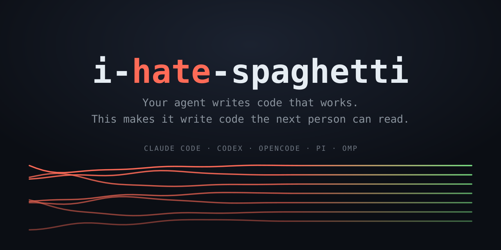

# i-hate-spaghetti

<p align="center">
  
</p>

**An agent skill that makes coding agents write code the next person can read — instead of code that merely runs.**

Works with Claude Code, Codex CLI, OpenCode, Pi, omp, and any agent that implements the [Agent Skills](https://agentskills.io) format.

```text
$ spaghetti.py sniff .
i-hate-spaghetti · project contract
stack:    ts(412) css(31) py(12)
size:     455 source files, 61,204 lines, max depth 4
build:    bun
scripts:  dev build test lint typecheck
lint:     eslint.config.js .prettierrc tsconfig.json
tests:    tests/ (dir, 88 files)
layout:   app components lib server scripts tests types
comments: light (6%) · line comments, doc blocks
biggest:
  lines  file
    912  server/routes/reports.ts
    604  lib/api/client.ts
naming:   kebab-case (dominant)
commits:  feat(billing): add retry on capture | fix: quote order id | chore: bump deps
```

That is the whole point: **one command, ~30 lines, instead of ten exploratory file reads.** The agent learns the house style before it writes a line, and it pays for that knowledge in tokens once.

## Why

Generated code fails in three predictable ways, and none of them are "it doesn't work":

1. **It ignores the house style.** A second way to do what the codebase already does eleven times. Every future reader now holds two patterns.
2. **It is structurally accidental.** Logic lands wherever the cursor was: a 300-line handler, a `utils.ts` that owns nothing, three layers of try/catch around a missing null check.
3. **It is loud.** Comments restating the code, commented-out code, unused flags, `TODO`s, debug prints — noise that costs tokens every time the file is read.

Linters catch line-level style. Reviewers catch logic. Nobody catches "this file no longer belongs to this codebase" — until it is six months old. This skill makes the agent do it while it is cheap: at write time.

## How it works

Five rules, in order:

1. **Learn the project before writing.** `sniff` reports the stack, the build/test/lint commands, the layout, the dominant naming style, the biggest files (your future split candidates), the comment register (density and form) and the commit-message convention.
2. **Read the neighbourhood.** The files the change touches, plus every caller of every function being modified. Missed callers are how a "small change" becomes a regression.
3. **Write the smallest coherent diff in the project's own pattern.** Not the smallest diff — the smallest *coherent* one. Reuse the existing helper; a guard in the shared function beats a guard in each of five callers. Extract on the third repetition, not the second — KISS, DRY and YAGNI are applied with judgment, not as a checklist.
4. **Measure the result.** `score` flags long files, long functions, deep nesting, duplicated blocks, commented-out code, TODOs and comment noise — per file, with line numbers. Exit code 1 when there is anything to look at, so it drops straight into a pre-commit hook or CI.
5. **Align the diff.** Re-read only the lines you added against the contract: naming, error style, comment register, test placement. Fixing your own diff is in scope; reformatting untouched code is not.

Learning first is the token-cheap order: rewriting a finished change to match a pattern costs more than matching it while writing. The final align step is a safety net over the diff, not a substitute for step 1 — and it never reformats the repo.

When the codebase's own pattern is the real problem (a 900-line module, swallowed errors, copy-paste everywhere), the agent does the task the existing way and **raises it once**, in one line, at the end. No unrequested refactors. Ever.

## Install

### Fastest — the skills CLI

```bash
npx skills add Chathula/i-hate-spaghetti     # pick your agents when prompted, or -g for global
```

That is the [skills.sh](https://skills.sh) path: no registry submission, the CLI reads `SKILL.md` straight from this repo and installs it wherever your agents look.

### One command, all agents (from a clone)

```bash
git clone https://github.com/Chathula/i-hate-spaghetti.git
cd i-hate-spaghetti
./install.sh                 # detects installed agents, installs for each
./install.sh --link          # symlink instead of copy (updates with git pull)
./install.sh --all           # install everywhere, even where detection is unsure
./install.sh --project ~/code/my-app   # install into that project only
```

### As a plugin (Claude Code, omp, anything with a plugin loader)

Claude Code, straight from the shell:

```bash
claude plugin marketplace add Chathula/i-hate-spaghetti
claude plugin install i-hate-spaghetti@i-hate-spaghetti
```

Or inside a session: `/plugin marketplace add Chathula/i-hate-spaghetti`, then `/plugin install i-hate-spaghetti`. It shows up as `/i-hate-spaghetti:i-hate-spaghetti`.

The repo is a plugin root — `.claude-plugin/plugin.json` plus `skills/i-hate-spaghetti/` — so the same tree also works with loaders that read a standard root `plugin.json` (omp's agent-plugins provider, and anything else following that convention):

```bash
omp --extension ~/code/i-hate-spaghetti        # or install the dir through your agent's plugin path
claude --plugin-dir ~/code/i-hate-spaghetti    # load without registering a marketplace
```

A plugin install is just the skill install with a management layer on top: same `SKILL.md`, same scripts, updated with one command.

### Where it lands

| Agent | User | Project |
|---|---|---|
| Claude Code | `~/.claude/skills/i-hate-spaghetti/` | `.claude/skills/…` |
| Codex CLI | `~/.codex/skills/i-hate-spaghetti/` | `.codex/skills/…` |
| OpenCode | `~/.config/opencode/skills/…` | `.opencode/skills/…` |
| Pi, omp, spec-compliant agents | `~/.agents/skills/…` | `.agents/skills/…` |

Manual install is one copy:

```bash
mkdir -p ~/.agents/skills && cp -r . ~/.agents/skills/i-hate-spaghetti
```

Codex CLI needs the skills feature enabled (`[features] skills = true` in `~/.codex/config.toml`); it also reads `.agents/skills`.
Claude Code, Codex and OpenCode all read `.agents/skills` too, so a single copy there covers most setups.

## Usage

The skill is model-invoked and **on by default for code**: write code as usual and it loads whenever the task touches code. To force it on a task it skipped:

```text
Claude Code    /i-hate-spaghetti
Codex CLI      $i-hate-spaghetti   (or /skills)
OpenCode       skill: i-hate-spaghetti
Pi / omp       /skill:i-hate-spaghetti
```

Turn it off with **"stop spaghetti"** or **"normal mode"** in a message. To run it as the last pass over a finished change — align the diff, do not reformat the repo — say **"align this change"** or invoke the `align` mode.

## The scripts, standalone

They are useful without any agent:

```bash
S=skills/i-hate-spaghetti/scripts/spaghetti.py
python3 $S sniff .                    # project contract
python3 $S score --diff               # only what you changed
python3 $S score --max-lines 300 src  # stricter thresholds
```

Exit codes: `0` clean, `1` findings, `2` usage error — drop it in CI:

```yaml
- run: python3 skills/i-hate-spaghetti/scripts/spaghetti.py score --max-func 50
```

`sniff` prints an aligned contract; `score` groups findings by file. Colors turn on for a terminal and stay off in pipes, CI and where `NO_COLOR` is set; `--color always|never` overrides.

Heuristics are language-agnostic: line and block comments, braces or indentation, C-family/JVM/Go/Rust/Swift/Dart signatures, keyword blocks (Python, Ruby, Elixir, Lua, Julia, Nim, ML, F#, VB), and plain structure — file size, TODOs, long lines — for everything else. Files with an unknown extension are skipped; add one line to `LANGS` in `analysis.py` to include a language.

Python 3.10+, standard library only, no dependencies, no network. Findings are heuristics: they point at code worth a second look, they do not judge it.

`skills/i-hate-spaghetti/scripts/analysis.py` is the library half (walking, measuring); `spaghetti.py` is the CLI. Import the former if you want the checks inside your own tooling.

Known false positives, by design and by name:

- marker words (`TODO`, `FIXME`) inside regex literals or fixture strings — the line is still worth a glance
- JSX/markup nesting, which is a template tree rather than control flow — the depth limit doubles automatically for `.tsx/.jsx/.vue/.svelte/.html`
- brace counting on template languages where `{` is data, not scope

## Cost

| Loaded | When | Size |
|---|---|---|
| Description only | every turn, in the skill index | ~80 tokens |
| `SKILL.md` | when a coding task starts | ~1.75k tokens (114 lines) |
| `references/*.md` | only when the skill points at one | ~0.65–1.2k each |
| `sniff` output | once per repo, per task | ~0.3k tokens instead of ~3–8k of exploring |

That is the design constraint: **the skill must cost less than the exploration it replaces**, or nobody keeps it installed. Deep material lives in `references/` and is read on demand; the main file stays short enough to load on every task without hesitation.

## What it is not

- Not a linter, formatter, or replacement for either. If the repo has one, the skill defers to it.
- Not a parser. Language support is a table plus generic comment/indent/brace heuristics, not a grammar per language — flags point at code worth a look.
- Not an auto-refactorer. It reports; the human decides.
- Not opinionated about your framework, language, or architecture — it takes its opinions from the repo it is standing in.
- Not a style police for code you did not touch. It governs the diff, not your weekend.

## Pairs well with

[ponytail](https://github.com/DietrichGebert/ponytail) answers *"does this need to exist?"* — the ladder, YAGNI, delete before add. **i-hate-spaghetti** answers *"now that it exists, does it belong?"* — structure, house style, and measured noise. Run both; they do not overlap.

## Contributing

Issues and PRs welcome. Rules for changes to the skill itself:

- Every rule added must be able to *change* what the agent writes. If it does not, it is prose, and prose costs tokens on every task.
- Prefer one new line in `references/smells.md` over a new section in `SKILL.md`.
- `python3 -m unittest discover -s tests` must pass, and `SKILL.md` must stay under 500 lines (the Agent Skills recommendation).

## License

MIT.

Artwork (`assets/banner.svg`, `assets/logo.svg`, and the rendered PNGs) is yours to use with the project — the banner is 1280×640, so it doubles as the repo's social preview: **Settings → Social preview → Upload** `assets/social-preview.png`.
